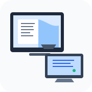
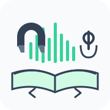
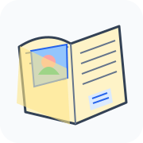
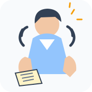

# Read Along — Sách điện tử kết hợp lời đọc

**Read Along** là ứng dụng kết hợp sách điện tử với lời đọc bằng âm thanh, giúp trẻ em và người học vừa nghe lời đọc vừa theo dõi nội dung văn bản tương ứng trên từng trang.

Ứng dụng hiển thị sách từ tệp PDF và phát tệp MP3 hoặc định dạng âm thanh được trình duyệt hỗ trợ. Các mốc thời gian cho phép liên kết thời điểm trong bản ghi âm với từng trang sách. Read Along chạy trên trình duyệt; PDF và âm thanh được người dùng mở từ thiết bị của mình.

## Read Along hoạt động như thế nào?

### Bước 1 — Mở sách

Chọn tệp PDF hoặc một thư mục chứa nhiều tập truyện. PDF là phần nội dung người đọc nhìn thấy trên màn hình.

### Bước 2 — Ghép lời đọc

Chọn tệp MP3 hoặc định dạng âm thanh được trình duyệt hỗ trợ, tương ứng với cuốn sách. Người đọc có thể nghe và theo dõi văn bản cùng lúc.

### Bước 3 — Đồng bộ âm thanh và trang

Gán thời điểm bắt đầu đọc cho từng trang. Khi âm thanh đến mốc đã thiết lập, Read Along có thể tự chuyển trang hoặc dừng để người đọc tự lật trang.

### Bước 4 — Nghe, đọc và luyện tập

Tua âm thanh, thay đổi tốc độ, đến trang bất kỳ hoặc nghe lại trang hiện tại để theo kịp lời đọc.

**Lưu mốc đồng bộ:** Có thể tải mốc thời gian thành tệp JSON hoặc đồng bộ lên GitHub. Tệp PDF và âm thanh vẫn nằm trên thiết bị của bạn.

1. **Mở sách:** chọn một tệp PDF hoặc một thư mục chứa nhiều tập truyện.
2. **Ghép lời đọc:** chọn tệp MP3/audio tương ứng với nội dung sách.
3. **Nghe và theo dõi:** phát âm thanh trong khi đọc nội dung trên trang PDF.
4. **Đồng bộ trang với âm thanh:** gán mốc thời gian cho các trang. Khi âm thanh đến mốc đã thiết lập, ứng dụng có thể tự chuyển trang, dừng chờ người đọc lật trang hoặc phát liên tục tùy chế độ.
5. **Điều khiển việc đọc:** tua âm thanh, thay đổi tốc độ, chuyển đến trang bất kỳ hoặc nghe lại trang hiện tại. Khi bật **Lật trang tự tua**, chuyển trang sẽ đưa âm thanh đến mốc của trang đó nếu mốc đã được thiết lập.
6. **Lưu mốc đồng bộ:** tải mốc thời gian thành tệp JSON hoặc chủ động đồng bộ lên GitHub. PDF và tệp âm thanh không được tải lên GitHub bởi chức năng đồng bộ mốc.

## Bắt đầu nhanh

1. Mở [Read Along trên GitHub Pages](https://blamag999.github.io/pdf-audio-sync/).
2. Nhấn **Bắt đầu**.
3. Chọn một trong hai cách:
   - **Chọn thư mục:** chọn thư mục có các tệp PDF/audio. Ứng dụng quét và hiển thị danh sách tập để bạn chọn.
   - **Chọn PDF:** chọn tài liệu PDF, sau đó nhấn **Chọn MP3** để nạp tệp âm thanh tương ứng.
4. Nhấn **Phát** để bắt đầu nghe. Việc nạp tệp không tự động phát âm thanh.
5. Nếu muốn đồng bộ trang, mở **Mốc thời gian**, phát đến thời điểm bắt đầu của trang rồi nhấn **Ghim mốc giây này cho trang**. Lặp lại cho các trang cần đồng bộ.

## Hướng dẫn sử dụng

### Chọn và mở nội dung
- **Bắt đầu → Chọn thư mục:** phù hợp khi có nhiều tập truyện. Chọn thư mục chứa các tệp PDF và audio; sau khi quét, mở **Danh sách tập** để chọn tập.
- **Bắt đầu → Chọn PDF:** phù hợp khi chỉ đọc một tài liệu. Sau khi chọn PDF, chọn thêm tệp âm thanh tương ứng bằng nút **Chọn MP3**.
- Có thể kéo thả tệp vào vùng đọc nếu trình duyệt và thiết bị hỗ trợ thao tác này.

### Điều khiển đọc
- **Phát/Tạm dừng:** phát hoặc tạm dừng âm thanh.
- **Trang trước/Trang sau:** chuyển trang PDF.
- **Tua lùi/Tua tới:** di chuyển âm thanh 5 giây.
- **Đọc lại trang:** phát lại từ mốc thời gian của trang hiện tại khi đã có mốc phù hợp.
- **Tốc độ phát:** chọn tốc độ từ 0,5× đến 3×.
- **Vừa dọc / 2 Trang:** thay đổi cách hiển thị PDF; dùng nút phóng to/thu nhỏ để điều chỉnh kích thước.
- **Đến trang:** nhập số trang để chuyển thẳng đến trang mong muốn.

### Chế độ đọc và đồng bộ mốc
- **Tự động lật trang (theo mốc thời gian):** tự chuyển PDF theo các mốc trang đã thiết lập khi âm thanh phát đến thời điểm tương ứng.
- **Dừng chờ lật trang:** dừng âm thanh tại mốc trang kế tiếp để người đọc tự lật trang rồi tiếp tục.
- **Đọc liên tục:** phát âm thanh mà không tự dừng hoặc tự chuyển trang theo mốc.
- **Lật trang tự tua:** khi bật, thao tác chuyển trang sẽ tua âm thanh đến mốc của trang đó nếu có.
- **Ghim mốc giây này cho trang:** gán thời điểm âm thanh hiện tại cho trang đang mở. Các mốc cần được thiết lập trước để đồng bộ chính xác.

### Lưu và đồng bộ dữ liệu
- Mốc thời gian được lưu cục bộ trong trình duyệt theo từng cuốn truyện.
- Dùng **Lưu mốc** để lưu hoặc tải tệp mốc JSON về máy.
- Trong **Mốc thời gian**, có thể nhập JSON, xuất JSON, xóa mốc hoặc đồng bộ mốc lên GitHub.
- Chức năng đồng bộ GitHub chỉ lưu dữ liệu JSON về mốc thời gian; PDF và audio không được tải lên.
- Để ghi dữ liệu vào repository, cần GitHub Personal Access Token có quyền **Contents: Read and write**. Token chỉ được giữ trong phiên trình duyệt hiện tại; không đưa token vào mã nguồn hoặc chia sẻ token.

### Menu
Nút **Menu** ở góc trên phải dùng để ẩn/hiện khu vực chọn tệp và thanh mốc trang phía dưới.

## Lưu ý
- Trình duyệt cần hỗ trợ chọn thư mục để sử dụng chức năng quét thư mục. Nếu không, hãy chọn PDF và audio riêng.
- PDF và audio được mở từ thiết bị của người dùng; chức năng đồng bộ mốc không tải các tệp này lên GitHub.
- Nếu giao diện chưa cập nhật sau khi triển khai, hãy tải lại trang bằng **Ctrl + F5** hoặc đóng rồi mở lại ứng dụng.

## Công nghệ
- **PDF.js:** hiển thị tài liệu PDF.
- **IndexedDB và bộ lưu trữ của trình duyệt:** lưu dữ liệu cục bộ của thư viện.
- **GitHub Contents API:** đồng bộ tệp JSON mốc thời gian khi người dùng chủ động yêu cầu.

## Repository
[blamag999/pdf-audio-sync](https://github.com/blamag999/pdf-audio-sync)
